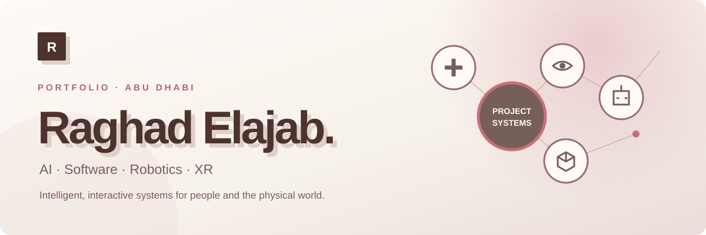

<p align="center">
  
</p>

<p align="center">
  <a href="https://raghad-elajab-portfolio.vercel.app/"><strong>View the live portfolio ↗</strong></a>
  &nbsp;&nbsp;·&nbsp;&nbsp;
  <a href="https://github.com/RaghadElajab">GitHub</a>
  &nbsp;&nbsp;·&nbsp;&nbsp;
  <a href="https://www.linkedin.com/in/raghad-elajab/">LinkedIn</a>
</p>

## About

I’m Raghad Elajab, a Computer Science student at Khalifa University building intelligent, interactive systems that connect software with people and the physical world.

This portfolio brings together my work across computer vision, healthcare AI, humanoid robotics, mixed reality, game development, and software systems. It is designed as an editorial project archive: each project opens into a focused case study with its tools, implementation details, outcomes, demos, and supporting visuals.

## Selected work

- **Jersey-Color Classification for RoboCup Humanoid Soccer** — a team-aware vision pipeline developed with KUCARS/KURA.
- **Budget-Aware Clinical Sequential Diagnosis** — an active feature-acquisition study balancing diagnostic performance and information cost.
- **Face Recognition Attendance** — a live multi-face attendance platform using FaceNet, SVM, OpenCV, and FastAPI.
- **ECoffe!** — a sustainability-focused VR café game for Meta Quest.
- **Garden Tomato** — a mixed-reality learning experience for Microsoft HoloLens with an AI-powered assistant.
- **Crop Disease Classification** — a reproducible comparison of deep-learning architectures across maize and cashew conditions.

## Portfolio features

- Responsive layouts for phone, tablet, and desktop
- Interactive project filtering and detailed project dashboards
- Embedded demos, diagrams, and external video links
- Accessible keyboard navigation and reduced-motion support
- A lightweight, framework-free implementation

## Built with

<p>
  <code>HTML5</code>&nbsp;
  <code>CSS3</code>&nbsp;
  <code>JavaScript</code>&nbsp;
  <code>Canvas API</code>&nbsp;
  <code>SVG</code>&nbsp;
  <code>Vercel</code>
</p>

## Run locally

Clone the repository and serve the directory with any static file server:

```bash
git clone https://github.com/RaghadElajab/portfolio.git
cd portfolio
python -m http.server 8000
```

Then open `http://localhost:8000`.

## Deployment

The production site is deployed on Vercel:

**[raghad-elajab-portfolio.vercel.app](https://raghad-elajab-portfolio.vercel.app/)**

<p align="center">
  <sub>Designed and built by Raghad Elajab · Abu Dhabi, UAE</sub>
</p>
